<!-- _class: lead -->
<!-- _paginate: false -->

# Semi-Realtime Data Warehouse with Trino, Apache Arrow, and Iceberg

joker1007 (Repro株式会社)

JJUG CCC Fall 2026

---

# 自己紹介

- 橋立友宏 (@joker1007)
- Repro株式会社 チーフアーキテクト
- 元々はRailsエンジニアだったが、最近はJavaばかり書いている
- 日本酒とクラフトビールが好き


---

# Asakusaから来た

活動中のRubyコミュニティで日本最古


---

# 最近の仕事


チーフアーキテクトとして、サービス全体の中長期的な技術選定、設計アドバイス、全体アーキテクチャのデザインなどをしている。

---

# Reproの事業

マーケティングオートメーションサービスを提供している。

- ユーザーの行動を分析・分類し
- 複数のチャネルで適切なキャンペーンを配信することで
- 顧客とエンドユーザーのコミュニケーションを支援する

大量の行動ログとユーザー属性をKafkaで受け取り、ストリーム処理している。

<!-- この辺までは前回のJJUG CCCの資料とほぼ同じ -->

---

# 今日話すこと

1分程度のリードタイムでデータをSQLで分析できるデータウェアハウスを次の技術を組み合わせて作った。

- Kafka / Kafka Streams
- Iceberg
- Apache Arrow
- DuckDB
- Arrow Flight SQL
- Trino

この辺りの技術要素について話す。気になったらこの辺りの名前でググったりお手元のAI Agentに聞いてみて欲しい。

---

# 作ったもの

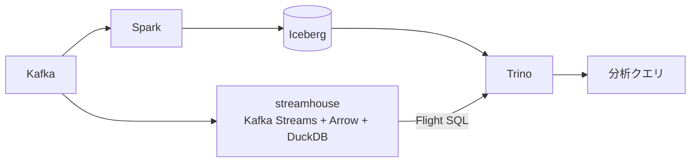

- 古いデータはIcebergに置く
- 直近のデータはstreamhouseというアプリケーションがメモリ上に持つ
- Trinoが両方を読み、1つのテーブルに見せる
- こう書くとシンプルだが、実際は結構大変

<!-- streamhouse は社内のアプリケーション。Flight SQL コネクタは trino-flight-sql-connector として別リポジトリにしている -->

---

# Arrowに分散クエリ可能にするものが世の中に全然無い

- spark -> Icebergは既によくある構成
- Arrowを上手く分散配置して蓄積したり、Trinoから複数のデータストアと組み合わせて透過的にクエリできる仕組みは世の中に無い

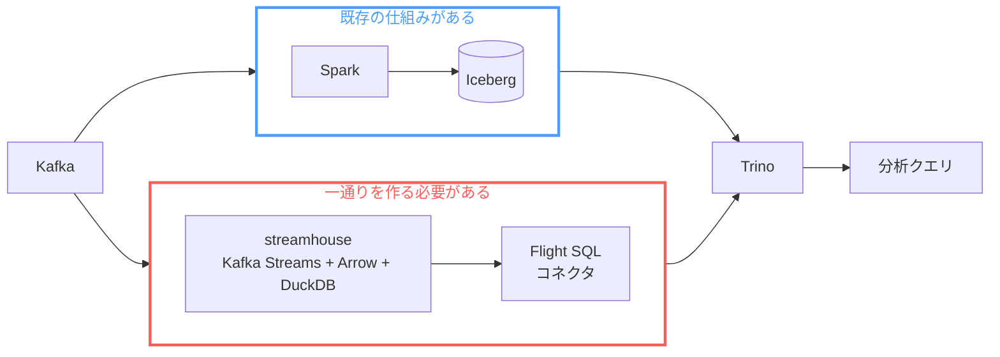

---

# 話の流れ

1. KafkaとKafka Streams
2. Icebergとその書き込み
3. Apache Arrowとゼロコピー
4. Kafka Streamsの上にArrowを蓄積する
5. DuckDBでクエリする
6. Flight SQLで外からクエリを受け付ける
7. TrinoのFlight SQLコネクタを作る

---
<!-- _class: lead -->

# 1. KafkaとKafka Streams

---

# Kafka

分散型のメッセージキュー。

- トピックはパーティションに分かれた追記専用のログ
- レコードはキーのハッシュでパーティションに振り分けられる
- Consumerは読み進めた位置 (offset) を自分で管理する
- 保持期間のあいだは何度でも読み直せる

「読み直せる追記ログ」という性質を、後で耐障害性を得るために使う。

---

# Kafka Streams

Kafkaのトピックを入出力にするストリーム処理のライブラリ。

- 専用のクラスタが要らず、普通のJavaアプリケーションとして動く
- パーティション単位のタスクをノードに割り当てて水平分割する
- ノードが増減すると、タスクを割り当て直す (rebalance)
- 集計などの状態はStateStoreに持つ

---

# KafkaとKafka Streamsについてはより詳しい過去の資料があります

実践Kafka Streams 〜イベント駆動型アーキテクチャを添えて〜

https://speakerdeck.com/joker1007/shi-jian-kafka-streams-ibentoqu-dong-xing-akitekutiyawotian-ete

---

# StateStoreとchangelog

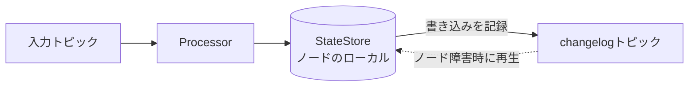

- StateStoreへの書き込みはchangelogトピックにも送られる
- ノードが落ちたら、別のノードがchangelogを再生して状態を復元する
- StateStoreは自分で実装できる (デフォルトはRocksDBを利用する)

---
<!-- _class: lead -->

# 2. Iceberg

---

# Iceberg

オブジェクトストレージ上のファイル群を1つのテーブルとして扱うためのテーブルフォーマット。
データファイルだけでなく、テーブルの構造のメタデータやクエリの仕方までを規格で定義している。

- データはParquetなどのファイル
- どのファイルがテーブルに属するかをメタデータで管理する
- コミットはメタデータの差し替えで、読み手は常に一貫したスナップショットを見る
- Spark、Trino、Flinkなど複数のエンジンから同じテーブルを読み書きできる

---

# テーブルの構造

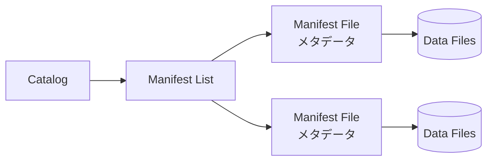

- Manifestにはファイルごとのパーティション値と列の最小値・最大値が入っている
- クエリエンジンはこれを見て、読むファイルを絞る

---

# Icebergを利用する上でのメリット

- 列指向フォーマットを利用しつつ、行ごとの更新や削除をサポートする
- 透過的なパーティショニングや、後からパーティションの切り方を変えたりできる
- メタデータの肥大化を抑えてパフォーマンス向上

---

# 透過的パーティショニング

パーティションをカラムの値を変換した結果として定義する。

```sql
CREATE TABLE prod.db.events (
  user_id BIGINT,
  event_name STRING,
  occurred_at TIMESTAMP
) USING iceberg
PARTITIONED BY (days(occurred_at), bucket(16, user_id));

SELECT count(*) FROM prod.db.events
WHERE occurred_at >= TIMESTAMP '2026-11-14 00:00:00';
```

クエリを書く人はカラムを普通にWHEREでフィルタするだけでよい。  
パーティション用の列を意識する必要がない。

---

# Hive形式のパーティションとの違い

- Hive形式では `dt = '2026-11-14'` のようなパーティション用の列を、書く側も読む側も知っている必要がある
- パーティション列で絞り忘れると全件スキャンになる
- Icebergは変換の定義をメタデータに持つので、エンジンが自動で絞る
- パーティションの切り方を後から変えても、既存のクエリを書き換えなくてよい (Partition Evolution)

---

# 更新と削除の2つの方式

Parquetファイルは書き換えられないので、更新と削除には工夫が要る。

| 方式 | 書き込み時 | 読み込み時 |
|---|---|---|
| Copy on Write | 対象行を含むファイルを丸ごと書き直す | そのまま読める |
| Merge on Read | 削除した行の情報だけを別ファイルに書く | データと削除情報を突き合わせる |

---

# Merge on Read

```sql
ALTER TABLE prod.db.user_profiles SET TBLPROPERTIES (
  'write.delete.mode' = 'merge-on-read',
  'write.update.mode' = 'merge-on-read',
  'write.merge.mode'  = 'merge-on-read'
);
```

- 書き込みが軽いので、更新の頻度を上げやすい
- 削除情報が溜まると読み込みが遅くなる
- 定期的なコンパクションでデータファイルに反映する

<!-- TODO: Reproでの実際の設定(v2のdelete fileかv3のdeletion vectorか、コンパクションの頻度)に合わせて書き直す -->

---

# Sparkでの書き込み

Kafkaから取り込んだ差分を `MERGE INTO` でテーブルに反映する。

```sql
MERGE INTO prod.db.user_profiles t
USING updates s
ON t.user_id = s.user_id AND t.profile_key = s.profile_key
WHEN MATCHED THEN UPDATE SET *
WHEN NOT MATCHED THEN INSERT *;
```

IcebergのSpark拡張がこのSQLを解釈し、テーブルの設定に従ってCopy on WriteかMerge on Readで書き込む。

<!-- TODO: Reproで実際に動かしているSparkジョブの形(バッチかStructured Streamingか、実行間隔)を確認して差し替える -->

---

# Structured Streamingでの書き込み

```java
Dataset<Row> events = spark.readStream()
    .format("kafka")
    .option("subscribe", "Events")
    .load();

events.writeStream()
    .format("iceberg")
    .outputMode("append")
    .trigger(Trigger.ProcessingTime(1, TimeUnit.MINUTES))
    .option("checkpointLocation", checkpointPath)
    .toTable("prod.db.events");
```

トリガーの間隔ごとにIcebergへコミットする。

---

# Icebergの限界

- コミットのたびにスナップショットと小さなファイルが増える
- 間隔を短くするほど、コンパクションとメタデータ整理の負荷が上がる
- Sparkジョブ自体の起動と実行にも時間がかかる
- ピーク時に秒間5万行の書き込み量を、IcebergにMERGEでUPSERTするとコミット間隔はどうやっても15分程度になる。

当然Icebergに書かれるまでの間のデータはクエリできない。  
しかし、機能的な要求は1分程度のリードタイムで分析できること。  
そのため、Icebergだけでは要件を満たせない。

---

# 直近のデータを別に持つ

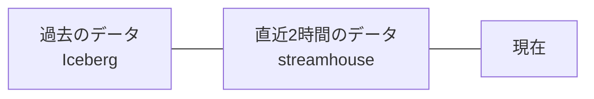

- Icebergに届いていない直近のデータをメモリ上の列指向データとして持つ
- クエリのときに両方を合わせて読む
- 要はBigQueryのストリーミングバッファの様なものを自作する

この「直近のデータ」を持つ形式としてApache Arrowを採用。

---
<!-- _class: lead -->

# 3. Apache Arrow

---

# Apache Arrow

オンメモリに最適化された列指向データフォーマット。  
列指向データをメモリ上でどう並べるかを定義しており、言語に依存しない仕様。

- 列ごとに値を連続したバッファに並べる
- Java、C++、Rust、Python、Go、Rubyなど多くの言語に実装がある
- どの言語でも同じバイト列になる
- 徹底したゼロコピー (詳しくは後述)

---

# 列指向のメモリレイアウト

| user_id | profile_key | profile_value |
|---|---|---|
| 1 | plan | free |
| 2 | plan | paid |
| 3 | region | tokyo |

- 行指向は1行分の値をまとめて並べる
- 列指向は `user_id` だけ、`profile_key` だけをそれぞれ連続して並べる
- 集計やフィルタは必要な列だけを読めばよい
- メモリ上の領域が集約されており、CPUキャッシュとSIMDを使いやすい

---

# ゼロコピー

従来のデータ形式はプロセスやライブラリの境界を越えるたびに、  
データを変換するのが普通だった。

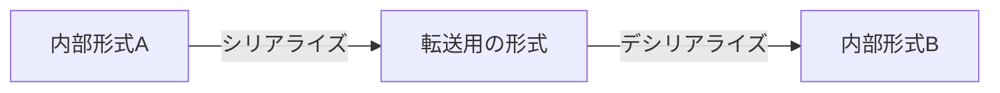

両方がArrowを内部形式として扱えるなら、この変換が要らない。

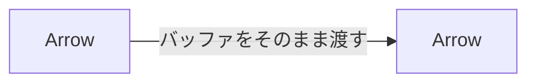

しかもオンメモリ上のバッファの持ち方と、転送時のIPCフォーマットがほぼ同じになっているため、プロセスをまたいだりファイルに書き出しても変換が必要無い。

---

# ゼロコピーを支える仕組み

- Arrow IPCフォーマットはメモリ上のバッファをほぼそのままファイルやネットワークに流す
- C Data Interfaceは同じプロセスの中の別の言語のライブラリへ、ポインタを渡すだけでデータを共有する
- Arrow Flight (後述) はgRPCの上でArrowのバッファを転送する

データ量が多いほど、ゼロコピー無変換による効率の良さが効果を発揮する。

---

# JavaでArrowを扱う

```java
try (BufferAllocator allocator = new RootAllocator();
     VectorSchemaRoot root = VectorSchemaRoot.create(schema, allocator)) {
  BigIntVector userId = (BigIntVector) root.getVector("user_id");
  VarCharVector key = (VarCharVector) root.getVector("profile_key");

  userId.setSafe(0, 42L);
  key.setSafe(0, "plan".getBytes(StandardCharsets.UTF_8));
  root.setRowCount(1);
}
```

- `VectorSchemaRoot` が1つのテーブル (レコードバッチ) にあたる
- バッファはヒープの外に確保され、`BufferAllocator` が管理する
- 使い終わったら `close()` で解放する。忘れるとリークとして検出される

---
<!-- _class: lead -->

# 4. Kafka Streamsの上にArrowを蓄積する

---

# streamhouse

Kafkaから受け取ったデータをArrowでメモリに蓄積し、SQLクエリを受け付けるアプリケーション。

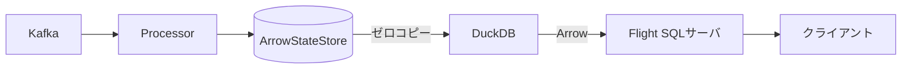

Kafka StreamsとQuarkusの上に実装している。

フレームワーク組込みのオンメモリストアではなくArrowフォーマットでデータを蓄積するカスタムStateStoreを実装した。

---

# メモリに置いたデータの耐障害性

メモリ上のデータはプロセスが落ちると消えてしまう。

- 再起動時にデータが失われない様にしたい
- 落ちたノードが持っていたデータを別のノードで復元したい
- ノードを増減したとき、データの担当を自動で割り当て直したい

これはKafka StreamsのStateStoreが解決している問題と同じ。  
ArrowをStateStoreとして実装すれば、フレームワークが持っているchangelogからの復元とrebalanceを利用できる。

---

# カスタムStateStoreで実装するもの

- `StateStore` インタフェース (`init` / `flush` / `close` など)
- `StoreBuilder` (TopologyにStoreを登録する)
- changelogへの書き込み
- changelogからの復元
- Processorから呼ぶ読み書きのメソッド

標準のStoreはキーと値のバイト列を持つが、今回は列に展開したArrowを持ちたいので自前で実装する必要があった。

---

# Topologyへの登録

```java
builder.addStateStore(
    new ArrowStoreBuilder<>(storeName, segmentIntervalMs, retentionMs, registry, codec)
        .withLoggingEnabled(changelogConfig())
        .withCachingDisabled());

builder.stream(definition.topic(), Consumed.with(codec.keySerde(), codec.serde()))
    .process(() -> new InsertProcessor<>(storeName, evictionIntervalMs), storeName);
```

この様にKafka StreamsのフレームワークのDSLに既存のStateStoreと同じように登録できる。

---

# レコードの追記

```java
public void insert(Record<K, V> record) {
  long timestamp = codec.timestampOf(record);
  lock.writeLock().lock();
  try {
    applyToSegment(record);   // Arrowの各列に値を書く
    expireSegmentsLocked(observedStreamTime);
  } finally {
    lock.writeLock().unlock();
  }
  Bytes keyBytes = Bytes.wrap(keySerializer.serialize(name, record.key()));
  byte[] valueBytes = codec.serde().serializer().serialize(name, record.value());
  internalContext
    .logChange(name, keyBytes, valueBytes, timestamp, Position.emptyPosition());
}
```

Arrowへの書き込みと同時に、`logChange`で同じレコードをchangelogへ送る。

<!-- logChange は Kafka Streams の内部API -->

---

# 追記だけにする

- 更新 (UPSERT) をせず、届いたレコードをすべて末尾に追記する
- 同じキーの古い行も残る。最新の行を選ぶのはクエリの役目にする
- 削除 (tombstone) も、値がnullの行として追記する

列指向のバッファは途中の行を書き換えるのが苦手なので、Store側を単純にした。

Iceberg側のUPDATEが可能である特性をスポイルしてクエリ時に複雑さを移すことになるが、これはトレードオフとして諦めた。

---

# 時系列セグメントと保持期間

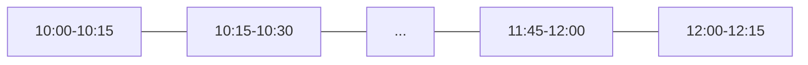

- レコードのタイムスタンプで15分ごとのセグメントに振り分ける
- 1セグメントが1つの `VectorSchemaRoot`
- 保持期間 (2時間) を過ぎたセグメントは、丸ごと `close()` して解放する
- 行単位の削除もコンパクションもしない

Kafka StreamsにはWindowStoreという仕組みがあり、その動作を参考にして実装した。

---

# changelogからの復元

```java
public void init(StateStoreContext context, StateStore root) {
  context.register(root, (RecordBatchingStateRestoreCallback) this::restoreBatch);
  // ...
}
```

- 起動時やrebalance後に、Kafka Streamsがchangelogのレコードを渡してくる
- デシリアライズして、追記と同じ処理でArrowに書く
- すでに保持期間を過ぎているレコードは、デシリアライズせずに読み飛ばす
- 復元が終わるまで、そのパーティションはクエリの対象にしない

---

# ローカルディスクへの退避

changelogを最初から再生すると、復元に時間がかかる。

- 書き込んだ行をArrow IPC形式のファイルにも書いておく
- 再起動のときはファイルから読み戻し、changelogは差分だけ再生する
- 無変換なのでディスクスループットの限界に近い速度で復旧できる
- standbyタスクはメモリにArrowを持たず、ファイルだけを更新する
- standbyがactiveに昇格したら、ファイルをメモリに展開する

Kafka Streamsは定期的に呼び出されるcommitのタイミングで `flush()` が呼ばれ、その後にcheckpointを書くので、`flush()` でファイルを `fsync` する。

---

# 書き込みとクエリの並行

ストリーム処理が書いている最中に、クエリのスレッドが読むケースに対応。

- 書き込みはwrite lock、スナップショットの取得はread lockで保護する
- スナップショットはバッファを共有するスライスで、コピーしない
- スライスを取った後はロックを持たずにクエリを実行できる

---
<!-- _class: lead -->

## ここまででKafkaに流れるデータをArrowに蓄積することが可能になった

## 次はSQLでクエリ可能にする必要がある


---
<!-- _class: lead -->

# 5. DuckDBでクエリする

---

# クエリエンジンを自分で書きたくない

蓄積したArrowに対して、フィルタ、集約、ウィンドウ関数を含むSQLを実行したい。

- SQLのパーサ、オプティマイザ、実行エンジンを自作するのは現実的でない
- Arrowを直接読める既存のエンジンを組み込む
- そういったもの自体は結構あるが、Javaから利用しやすいもので安定しているものが良い

---

# DuckDB

アプリケーションのプロセスに組み込んで使う分析用のデータベース。

- サーバを立てず、ライブラリとして読み込む
- 列指向のベクトル化実行エンジンを持つ
- JavaからはJDBCドライバとして使える
- ArrowのデータをC Data Interface経由でそのままスキャンできる
- 開発が活発で利用事例も多い

---

# ArrowをDuckDBのテーブルとして登録

```java
DuckDBConnection conn =
    (DuckDBConnection) DriverManager.getConnection("jdbc:duckdb:");

ArrowArrayStream stream = ArrowArrayStream.allocateNew(allocator);
Data.exportArrayStream(allocator, segmentReader, stream);
conn.registerArrowStream("user_profiles", stream);

DuckDBResultSet rs = (DuckDBResultSet) conn.prepareStatement(sql).executeQuery();
ArrowReader result = (ArrowReader) rs.arrowExportStream(allocator, batchSize);
```

- クエリごとに接続を作り、Storeのスナップショットをテーブルとして登録する
- 結果もArrowのまま受け取る
- 入力から出力まで、行指向への変換が一度もない

---

# JVMとネイティブの境界の注意点

- Arrowのバッファはヒープの外にあり、解放の順序を間違えるとリークやクラッシュになる
- DuckDBがスキャンしている間は、元のバッファを解放してはいけない
- クエリごとに子の `BufferAllocator` を作り、閉じるときにリークを検出する
- DuckDBのメモリ上限を設定し、重いクエリがストリーム処理を巻き込まないようにする

---
<!-- _class: lead -->

## これでプロセス内からクエリ可能になった

## 次は外部からリクエスト可能にしたい


---
<!-- _class: lead -->

# 6. Flight SQLで外からクエリを受け付ける

---

# Arrow FlightとFlight SQL

Arrow FlightはArrowのデータをgRPCで転送するためのプロトコル。

Flight SQLはその上にSQLデータベースとしての操作を定義したもの。

- SQLの実行、プリペアドステートメント、メタデータの取得
- 結果はArrowのレコードバッチのストリームで返る
- JDBCやADBCのドライバがあり、クライアントを自作しなくてよい
- 但し、分散処理を念頭においたプロトコルになっていて仕様が結構複雑
- 実際に活用されている話は余り見ない

---

# クエリの流れ

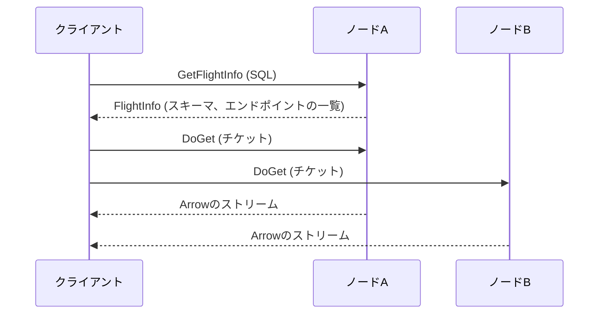

<!-- 問い合わせと結果の取得が分かれていて、結果は複数のエンドポイントから並列に取れる。 -->

---

# サーバの実装

Arrowが用意している `BasicFlightSqlProducer` を継承し、必要なメソッドを実装する。

```java
public class StreamhouseFlightSqlProducer extends BasicFlightSqlProducer {
  @Override
  protected <T extends Message> List<FlightEndpoint> determineEndpoints(
      T command, FlightDescriptor descriptor, Schema schema) { ... }

  @Override
  public FlightInfo getFlightInfoStatement(
      CommandStatementQuery command, CallContext context, FlightDescriptor descriptor) { ... }

  @Override
  public void getStreamStatement(
      TicketStatementQuery ticket, CallContext context, ServerStreamListener listener) { ... }
}
```

---

# 結果を流す

```java
try (QueryResult result = queryEngine.execute(sql, expectedPartitions)) {
  boolean hasData = result.reader.loadNextBatch();
  listener.start(result.reader.getVectorSchemaRoot());
  if (hasData) {
    listener.putNext();
    while (result.reader.loadNextBatch()) {
      listener.putNext();
    }
  }
  listener.completed();
}
```

DuckDBが返したArrowのバッチをそのままgRPCのストリームに載せる。
ここでも無変換で済むのがArrow Backend + Flight SQLの利点。

---

# 複数ノードへの分散

各ノードは自分に割り当てられたパーティションのデータだけを持っている。

- クエリを受けたノードがKafka Streamsのメタデータから全ノードの一覧を得る
- ノードごとにエンドポイントを作り、チケットにSQLを入れて返す
- クライアントは全エンドポイントから結果を取り、合わせる

以前のJJUG CCCで紹介したInteractive Queriesの仕組みをここで使っている。

---

# rebalance中のクエリ

rebalanceの途中では、復元が終わっていないパーティションがある。

- クエリを受けたノードは、各ノードが担当しているパーティションを問い合わせる
- 全パーティションがちょうど1回ずつ担当されていなければ `UNAVAILABLE` を返す
- 各ノードは実行するときに、担当が変わっていないかをもう一度確かめる
- rebalance自体はそれなりに時間がかかる処理でもあるので、出来る限りクエリ受け付けを止めないための工夫をしている

行が欠けた結果をエラーにせず返すと、キャンペーンの誤配信に繋がるので許容できない。

失敗させてクライアントで再試行する。

---
<!-- _class: lead -->

## 外部からのクエリが可能になった
## 次はTrinoからそれを使える様にしたい

---
<!-- _class: lead -->

# 7. TrinoのFlight SQLコネクタを作る

---

# Trino

分散SQLクエリエンジン。

- データを自分では持たず、コネクタ経由で外部のデータソースを読む
- Iceberg、Hive、RDBなど多くのコネクタがある
- 異なるデータソースのテーブルを1つのクエリでJOINやUNIONできる

Icebergとstreamhouse(Arrow + DuckDB + Flight SQL)をTrinoから読めれば、利用者には1つのテーブルに見せられる。

---

# trino-flight-sql-connector
https://github.com/reproio/trino-flight-sql-connector

さっきのKafka Streams基盤は社内システムのコンポーネントだが、これは一応OSSのコネクタとして公開している。

- Flight SQLの複数エンドポイントに対応し、並列読み込みをサポート
- シンプルなPredicate Pushdownに対応
- JDBCは利用していない
- Read Only
- JDK24以上、Trino 476以上が必要

---

# コネクタを自作した理由

そもそもFlight SQLを読めるコネクタが無い。

JDBCドライバとJDBCベースのコネクタを改造することもできたが、  
JDBCを経由すると次の問題がある。

- Arrowで届いた列指向のデータを `ResultSet` で行ごとに取り出すことになる
- 複数のエンドポイントから並列に読む仕組みを活かせない

データの取得効率に問題があるし、後者は特にパフォーマンスに影響する。

そこで、Arrowのまま受け取ってTrinoの内部形式に変換するコネクタを作った。  
クライアントにはADBCのFlight SQLドライバを使っている。

---

# コネクタの全体像

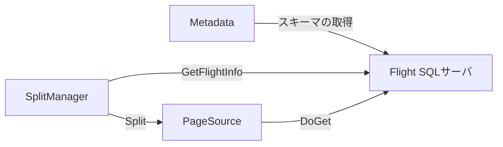

- CoordinatorでMetadataとSplitManagerが動く
- SplitManagerはエンドポイントごとにSplitを作り、Workerに配る
- WorkerでPageSourceが動き、ArrowをTrinoのPageに変換する

---

# プラグインの構成要素

| クラス | 役割 |
|---|---|
| `Plugin` | Trinoが最初に読み込むクラス |
| `ConnectorFactory` | カタログの設定からConnectorを作る |
| `Connector` | 下の3つをTrinoに渡す |
| `ConnectorMetadata` | テーブルと列の情報、pushdown |
| `ConnectorSplitManager` | 読み出しの分割単位 (Split) を作る |
| `ConnectorPageSourceProvider` | SplitからPageSourceを作る |

`ConnectorPageSource` がデータを読み、Pageにして返す。

---

# ほかに必要なもの

- `ConnectorTableHandle` / `ColumnHandle` / `ConnectorSplit` / `ConnectorTransactionHandle`
  - CoordinatorからWorkerへJSONで送られるので、シリアライズできる必要がある
- 設定クラス (`@Config` でカタログのプロパティを受ける)
- Guiceのモジュール
- 型の対応付け (ArrowのTypeとTrinoのType)
- SQLの組み立て (pushdownされた条件を `WHERE` に直す)

読み取り専用の最小限の実装で、本体は18クラス、約2,100行になった。

---

# PluginとConnectorFactory

```java
public class FlightSqlPlugin implements Plugin {
  @Override
  public Iterable<ConnectorFactory> getConnectorFactories() {
    return ImmutableList.of(new FlightSqlConnectorFactory());
  }
}

public class FlightSqlConnectorFactory implements ConnectorFactory {
  @Override
  public String getName() { return "flight_sql"; }

  @Override
  public Connector create(String catalogName, Map<String, String> config, ConnectorContext context) {
    Bootstrap app = new Bootstrap(new JsonModule(), new FlightSqlConnectorModule());
    Injector injector = app.setRequiredConfigurationProperties(config).initialize();
    return injector.getInstance(FlightSqlConnector.class);
  }
}
```

---

# Metadata

Trinoからの「どんなテーブルがあるか」「どんな列があるか」に答える。

- `listSchemaNames` / `listTables`
  - 接続先の `information_schema` などにSQLを投げて一覧を取る
- `getTableHandle` / `getColumnHandles`
  - `SELECT * FROM t WHERE 1=0` を投げ、返ってきたArrowのスキーマから列を作る

Flight SQLにはメタデータ取得用のコマンドがあるが、サーバ側で実装されていないことが多く、SQLで代替した。

---

# Pushdown

Trinoが組み立てた実行計画のうち、接続先に任せられる部分を引き受ける。

- `applyFilter`
  - `TupleDomain` で渡される列ごとの条件を `WHERE` 句に変換する
  - 変換できない条件はTrinoに戻し、Trino側で評価してもらう
- `applyProjection`
  - 必要な列だけを `SELECT` に並べる

引き受けた内容はTableHandleに持たせ、後でSQLを組み立てるときに使う。

---

# SplitManager

```java
public ConnectorSplitSource getSplits(...) {
  FlightSqlTableHandle handle = (FlightSqlTableHandle) tableHandle;
  String sql = queryBuilder.build(handle, columns);
  PartitionedExecuteResult result = client.executePartitioned(sql);

  ImmutableList.Builder<ConnectorSplit> splits = ImmutableList.builder();
  for (byte[] descriptor : result.partitionDescriptors()) {
    splits.add(FlightSqlSplit.partition(encoder.encodeToString(descriptor)));
  }
  return new FixedSplitSource(splits.build());
}
```

- Flight SQLサーバが返したエンドポイント1つをTrinoのSplit1つに対応させる
- streamhouseのノード数だけ、TrinoのWorkerが並列に読み出す

---

# PageSource

```java
public SourcePage getNextSourcePage() {
  if (!reader.reader().loadNextBatch()) {
    finished = true;
    return null;
  }
  VectorSchemaRoot root = reader.reader().getVectorSchemaRoot();
  Page page = pageBuilder.build(root, trinoTypes, arrowFieldNames);
  return SourcePage.create(page);
}
```

- Workerが自分に割り当てられたSplitのチケットで `DoGet` する
- Arrowのバッチを1つ受け取るごとに、Trinoの `Page` を1つ作る
- 変換は列ごとに、型に合わせた専用のループで行う

---

# 型の対応付け

| Arrow | Trino |
|---|---|
| `Bool` | `BOOLEAN` |
| `Int(8/16/32/64)` | `TINYINT` / `SMALLINT` / `INTEGER` / `BIGINT` |
| `FloatingPoint` | `REAL` / `DOUBLE` |
| `Decimal(p, s)` | `DECIMAL(p, s)` |
| `Utf8` | `VARCHAR` |
| `Date` / `Time` / `Timestamp` | `DATE` / `TIME(p)` / `TIMESTAMP(p)` |

精度やタイムゾーンの有無で分岐が増える。ネストした型にはまだ対応していない。

---
<!-- _class: lead -->

# クッソ大変
構成要素が多過ぎる

やってられるか、という感じ

---

<!-- _class: lead -->

## ジェバンニ(Fable)が
## 一晩でやってくれました
マジか……って感じだけど出来てしまった

---

# この話のオチ

- ArrowのStateStoreもTrinoのコネクターもほとんどAI Agentが書いてくれた
- Kafka Streamsのスタンバイ遷移のコントロールなども同様
- 実際にproductionレベルで検証するのに1週間程で到達した

構想自体は1年以上前から持っていた。

しかしそれを形にしようとすると、集中してやっても1ヶ月以上、その他の仕事を抱えながらだったら四半期丸々はかかるだろうと二の足を踏んでいた。

Fableが登場した辺りで、いけそうだなと思い、実際にやってみたら本当に出来てしまった。

---

# 一応工夫はしている

- 構想はしっかり練っていたので、ガッツリ説明してplanモードで半日ぐらいかけて設計をブラッシュアップ
- ミニマルな検証実装を作らせて、自分でもちゃんと動作確認
- 参照可能な公式のソースや社内の既存実装は全て自分で把握していて、設計段階でコンテキストに投入済み
- コンテナで動作テストまできっちりやらせ、並行して検証基盤のインフラ整備
- Kafkaの特性を活かして、既存システムに影響を与えずにストリームパイプラインを増やすノウハウは持っていた

という訳で、事前の準備がしっかり活きた形で、AI活用としても良い成果が出せたと思う。

---

# 最後の工程としてIcebergとUNIONする

```sql
CREATE VIEW analytics.event_counters_per_day_all AS
SELECT * FROM iceberg.analytics.event_counters_per_day
UNION ALL
SELECT * FROM flight_sql.main.event_counters_per_day;
```

- streamhouseのテーブル名はIcebergのテーブル名と同じにしてある
- 利用者はViewにクエリするだけで、直近のデータまで含めた結果が得られる

<!-- 実際には重なる期間の扱いとかでもうちょっとクエリは複雑 -->

---

# 全体をもう一度


---

# まとめ

- Icebergは透過的パーティショニングとMerge on Readで扱いやすいが、書き込みの間隔より新しいデータは見えない
- 直近のデータをArrowでメモリに持ち、Kafka StreamsのカスタムStateStoreにすることでオンメモリの柔軟さと耐障害性を両立
- DuckDBとFlight SQLを組み込むと、クエリエンジンとプロトコルを自作せずにSQLを受け付けられる
- Trinoのコネクタは作るものが多いが、SPIに沿って埋めていけば動く
- 参考実装は豊富なので今ならAI Agentが上手くやってくれる
- Arrowのゼロコピーと無変換はハイパフォーマンス要求に有効

---

# 参考資料

- https://kafka.apache.org/documentation/streams/
- https://iceberg.apache.org/docs/latest/
- https://arrow.apache.org/docs/java/
- https://arrow.apache.org/docs/format/FlightSql.html
- https://duckdb.org/docs/stable/clients/java
- https://trino.io/docs/current/develop/connectors.html
- https://github.com/reproio/trino-flight-sql-connector
